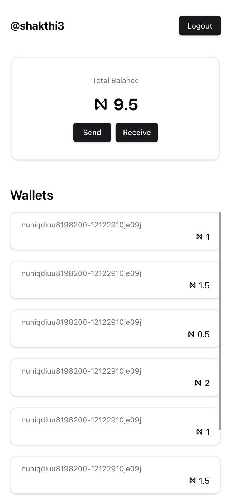
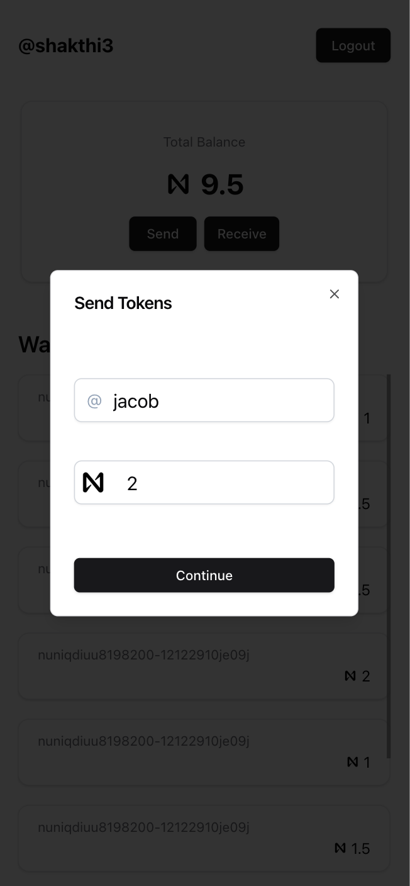
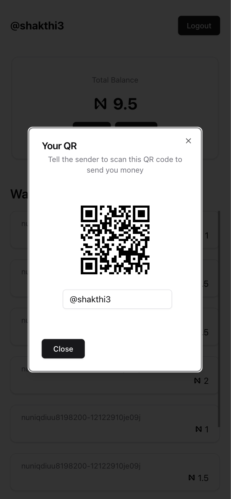

# ⚡️ ZAP

**Zap** is a proof-of-concept payments platform exploring how to make everyday crypto transactions gas-free and scalable so you can pay for your morning coffee without clogging the blockchain.  

Built on the **NEAR Blockchain**  

🏆 **Winner of the NEAR Sponsor Prize at HacksCanada 2025**

## Motivation
The idea for *Zap* came from the challenge that mainstream blockchains like Bitcoin aren’t designed for high-volume, real-time transactions. While they excel at security and decentralization, they struggle to handle millions of microtransactions. *Zap* was created to reimagine how blockchain could be used for instant, feeless daily payments.  

## Concept 💡
Unlike traditional bank accounts, crypto wallets aren’t inherently tied to one person. *Zap* leverages this by splitting crypto holdings into smaller, transferable chunks.  
Instead of moving tokens on-chain for every payment, *Zap* transfers wallet access keys effectively handing over ownership, just like passing a physical key to a locker full of gold.  

## Features
- 🔗 QR-based payments  
- 💸 Load tokens from external platforms (via testnet faucet prototype)  
- 🙋‍♂️ Send and receive using usernames  
- ⚖️ Smart token-splitting for efficient transactions  
- 🧠 Optimized algorithm for payment routing  
- 🔐 Secure authentication with **Bcrypt.js** and **JWT**  

## Screenshots

  
  
  

## Tech Stack
**Frontend:** Next.js · Tailwind CSS · TypeScript · Shadcn  
**Backend:** Express.js · Node.js · Supabase  

## Future Directions
The original concept envisioned a **React Native** mobile app with **peer-to-peer NFC key transfers** for instant crypto handoffs.  
However, due to Apple’s restrictions on NFC access, we pivoted to a web-based implementation for the prototype. Future versions may revisit the mobile-first approach as platform access improves.  

## License
This project is currently shared as a proof-of-concept and educational prototype.
Feel free to explore, fork! ⚡️